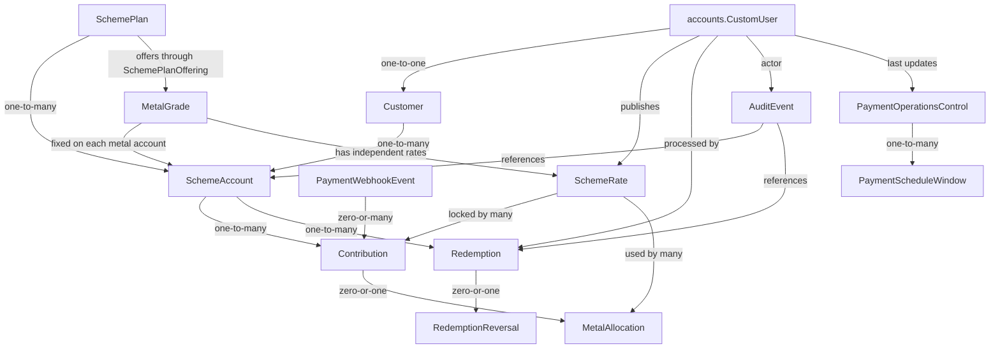

# Architecture

## System context

This is a server-rendered, single-business Django application. Customers authenticate by email through django-allauth. Owners manage customers and enrolments; customers can view only their own scheme accounts.

## Django apps

- `accounts`: Lithium's custom user, allauth integration, and simple `OWNER`/`STAFF`/`CUSTOMER` application roles.
- `pages`: Django-owned landing, policy, contact, and savings-plan views plus the
  rollout-gated Wagtail About and Our Story editorial page types. Stable Django named
  routes serve a live/public CMS revision only when explicitly enabled and otherwise
  retain the reviewed static fallback.
- `catalog`: bounded Wagtail catalogue pages, taxonomy, public discovery, and
  separately scoped catalogue authorization.
- `schemes`: customer profiles, reusable plans, scheme agreements, contributions, payment boundary, services, selectors, forms, and owner/customer views.

## Model relationships

`SchemeAccount` snapshots plan terms during enrolment so later plan edits do not
change existing agreements. A metal account also fixes one immutable `MetalGrade`;
changing a plan offering affects only future enrolment. Cash agreements snapshot the
bonus policy version, percentage, and minimum qualifying duration.

## Workspace presentation refinement (22 October 2026)

Role-specific Django includes provide a persistent owner rail/mobile drawer and a
customer Home / My plans / Applications / Documents / Help navigation. Owner customer
context links Summary, Applications, Plans, Payments, Documents and Access & privacy. These links
are presentation only; existing view/service permissions still authorize every request.
Customer receipts, applications and histories are scoped through approved identity/FKs,
never an email match. Agreements page at 12 records and histories/receipts at 25; printed
statements retain their complete financial evidence. Home highlights unresolved attempts
and first-payment stages once, with compact plan balances and separate application history.

Payment filters share one validated selector between the list and CSV. Dates mean attempt
creation dates in the configured business timezone. Selected-record totals cover the entire
filtered set (not only the current page); Live/cash and Test/practice amounts remain separate.
CSV still excludes pending/failed/closed attempts and does not imply settlement. Cash-entry
GET preflight reads existing blockers; preview/commit services retain their independent checks.

Application stage tabs/counts share the scoped union selector and count linked identity/plan
records once. Access & privacy lists exact-customer privacy requests, 25 per page, with shared
customer context and a return path from review. Protected progress shows six record-derived
milestones through login and first payment. Successful Live Razorpay or showroom-cash records
complete first payment; reversed/Test/practice attempts do not. Legacy agreements acquire no
fabricated intake history. Print documents label Test/practice without changing liabilities.

The read-only HTMX 2.0.11 pilot enhances owner customer search/pagination, application/payment/
exception filters and manual customer recorded-status refresh. Local static assets (with upstream license and official SHA-384) use
existing HTML views/includes, not a JSON API. Only those five screens load HTMX; consequential
POSTs, private progress/verification/setup and checkout remain normal flows. There is no
background polling, automatic mutation retry or blanket link boosting. Search debounces and
replaces older requests; normal forms/URLs work without JavaScript. Filter swaps update the
whole workspace: results, totals, stage counts, customer context and CSV links together, then
focus the replacement. These reads never contact a provider. Private responses are
no-store and vary on fragment/history-restore hints. HX-Request never grants authorization;
expired fragment sessions use HX-Redirect to the existing login. Full history restoration
gets a complete page. History snapshots are disabled (hx-history=false, historyCacheSize=0),
script evaluation/swapping is disabled and requests stay on this origin. No analytics/logging
of fragment headers, search terms or payment references is added. Caddy strips query strings,
Referer and Hx-Current-Url; Django redacts private search/return queries. Existing secret-path
exclusions remain. Prepared proxy changes require the approved deployment procedure.

## Layers

The Phase 2 owner entry is `schemes:owner_today`; `owner_dashboard` remains the
financial overview. Today shows bounded application and financial-exception previews,
with full counts and links to paginated queues. The Applications inbox combines
registration and enrolment-request keys through an ORM SQL union, orders by stage,
time and stable type/ID ties, and hydrates only the current page's evidence. Financial
exceptions use the same bounded-key approach for contributions and webhooks; these
are exception records, not a count of distinct affected payments.

Registration and plan reviews share `application_review.html`. Plan preferences,
offer snapshots, current-term confirmation and the agreement form are visible in
one workspace, using existing owner-only decision/conversion services. Legacy URLs
remain supported and bounded. The shared customer context links the customer record,
scoped applications, contributions and agreement statement across enrolment,
recovery, cash recording/correction, redemption and documents. An applicant is linked
to a customer only through the approved-user relationship, never by matching an
unverified email. Customers receive none of the owner navigation/context controls.

Customer search accepts at most 100 characters and returns 25 records per page,
with stable ordering and aggregate agreement counts. It searches name, email, mobile,
customer number and scheme number without loading all accounts/contributions.
Contribution and historical review lists also use fixed 25-record pages. These
selectors bound materialized records; count/search queries still use the database.
Phase 2 introduced no new model or financial mutation; Phase 3 orchestration is described below.

- Views authorize, validate forms, call services/selectors, and render or redirect.
- Services own transactional mutations such as customer creation, enrolment, and redemption.
- Selectors own reusable reads such as customer scheme summaries.
- The owner liability selector derives separate INR and exact-grade metal obligations
  and applies each grade's current published Scheme Rate only for indicative exposure.
- The redemption eligibility selector partitions open accounts from their snapshotted `eligible_from` dates into non-overlapping owner forecast windows without mutating account state.
- Document selectors assemble printable receipts and lifetime statements directly from verified contributions, immutable allocation snapshots, redemptions, reversals, and current derived entitlement. They do not copy financial data into a reporting ledger.
- Models and database constraints protect structural invariants.

## Authentication and authorization

Lithium's `CustomUser` and django-allauth remain authoritative. Superusers and `OWNER` users have owner access. Customer queries are always scoped through the authenticated user's one-to-one `Customer` record.

Public customer signup is intentionally closed during the MVP. The owner creates the
customer login and profile transactionally with an unusable password. The application
then emails a one-time, time-limited setup URL whose random secret is stored only as a
SHA-256 digest. The customer chooses their own password; successful setup also records
the allauth email address as verified. Owners can replace an unused invitation, which
revokes every previous live invitation, but an activated login uses password reset.
Invitation email-provider acceptance and login activation remain separate from the
financial agreement, including when Phase 3 coordinates its creation with identity
approval. This prevents an allauth login from being mistaken
for an active financial agreement.

Authentication emails opt out of Postmark link/open tracking so password and invitation
URLs remain direct first-party links. Django marks token-bearing responses `no-store`
with a `strict-origin` policy: same-origin password submissions remain CSRF-verifiable,
but subresources receive no secret-bearing URL path. The production Caddy profile
excludes the token paths from access logs. The web container emits application/error logs but no second
Gunicorn access log, and a console logging filter redacts either sensitive path if a
Django CSRF warning or application error references it. An internal error log cannot
bypass the edge filter and retain the raw token.
Nonblank `CustomUser.email` values are unique case-insensitively;
the deployment preflight stops rather than guessing how to combine historical users.

ADR-0015 adds a separate, fail-closed account-deletion workflow. A public request is
enumeration-resistant and email-verified; an authenticated customer request requires
recent local reauthentication. Verification invokes an explicit atomic containment
service that disables the login, revokes sessions and Google linkage, supersedes
unused invitations, and appends privacy actions while leaving the protected customer
and financial graph intact. The owner queue is a selector over current requests and
financial context. Its first phase can append only a reasoned hold and review date.
The next local increment adds a non-cacheable, read-only owner disposition preview
using existing financial selectors for separate agreement/grade balances and an
explicit external-review checklist. ADR-0015's 10 September revision permits
owner-operated development without a blanket professional-sign-off prerequisite.
The local completion service now requires documented field/category dispositions,
preserves financial history and commits a separate retryable notice queue. The
`privacy_erased_at` guard prevents ordinary credential/profile restoration and new
enrolment/contribution initiation. Retention reviews append decisions and may remove
additional eligible profile fields; they never purge financial history. Production
enablement remains a separate policy/procedure and synthetic-acceptance gate.

Wagtail authorization is independent of application roles. Dedicated Editorial and
Catalogue groups scope page and media access to their respective content; neither an
application `OWNER` role nor membership in one CMS area grants access to the other.
The homepage, policies, contact identity, `SchemePlan`, and every financial workflow
remain Django-owned.

### Staged registration and approved application redesign

Legacy access-only registration remains a feature-gated, complete-profile application
with protected email verification, recorded policy consent, duplicate/abuse controls,
explicit owner mobile verification and owner approval. Approval creates the existing
identity/profile and invitation; an agreement still requires separate owner enrolment.
Default allauth signup remains closed. Newly linked plan applications use the Phase 3
journey below. ADR-0011 and ADR-0012 describe both preserved and amended boundaries.

The owner approved a four-phase plan-first redesign on 5 October 2026, tracked in
`MVP_PLAN.md`. Phase 1 uses one shared record-driven offer card for home/comparison,
excludes unreviewed free-text descriptions, and routes `/plans/<id>/apply/` to the
existing customer request or staged registration with a validated offer summary.
Phase 3 now retains plan/grade/preferences across verification in an additive
`accounts.PlanApplication`, linked one-to-one to the existing registration and later
to one separate financial agreement. `PlanApplicationConfirmation` appends initial
and final offer/preferences/policy evidence; it is not a financial ledger. Remaining
address and current-offer/start-date confirmation follow email verification.

`accounts.applications` is the explicit orchestration service; application selectors
and server-rendered forms/views supply the progress and owner workspace. Mutations
lock registration, then application, then plan/offering. Approval rechecks identity
conflicts and customer-confirmed terms, calls existing identity/invitation and enrolment
services, and links their results in one transaction. One-to-one linkage and row locks
serialize retries; failure leaves no partial login/invitation/agreement. Financial
snapshots/audit evidence remain in `schemes`; identity/contact review evidence remains
on the registration. Email callbacks run only after commit, record failure and can be
recovered through owner invitation/progress replacement controls.

Progress has a separate random digest-only email secret and bounded application expiry.
A CSRF POST grants a server-side session; subsequent progress uses a token-free URL and
rechecks digest/expiry/approved-user eligibility. Replacement invalidates old sessions;
privacy containment revokes access and completion minimizes the optional message.
GET grants no credential, consumes no verification and mutates no financial record.
Both progress paths are protected in Django and Caddy logs/referrers and excluded from
funnel measurement. Public allauth signup and all existing authentication stay closed/
unchanged. Legacy registrations are not assigned inferred plans; existing customers
reuse their held profile through the authenticated enrolment-request flow. No generic
repository, event bus, internal REST API, worker or extra runtime component is introduced.

Customer payment presentation uses a selector for operational and agreement
availability; services remain authoritative for mutation checks. The protected
server-rendered payment-status route reads only customer-owned contribution state,
is non-cacheable and has no provider call or financial write on GET. Browser outcome
uncertainty goes there; it cannot classify a payment as failed or credited.

Checkout coordination lives in `checkout_services.py`, with read-only continuation
in `checkout_selectors.py`. `RazorpayCheckoutSubmission` retains browser submission
aliases; signed form context binds each submission to the agreement/mode and payment
history shown when the form was opened. `RazorpayOrderRequest` commits original
amount/mode/rate/deadline and a unique request token before provider I/O. Account
locking and a partial database uniqueness constraint prevent overlapping unresolved
Razorpay contributions, including flexible agreements. No provider create is retried
after uncertainty. `RazorpayOrderRecovery` retains owner/provider identity evidence
without crediting money or reopening checkout. Capture and allocation continue through
the existing financial services. These coordination records are not a balance ledger.

### Activation continuation and recovery

Phase 4 keeps password setup and sign-in separate. `activated_plan_url` selects only
an explicitly linked agreement owned by the approved user; password setup redirects
to the existing allauth login with that local `next` destination. No automatic login,
agreement creation or payment occurs on activation. Legacy invitations use their
existing login destination. Progress links also preserve the approved-plan destination.

Customer dashboard previews are bounded to three linked applications and three
existing-customer requests, with pending requests prioritized. Their stages/actions
precede balances. The plan next-action selector reads contribution status and existing
availability; uncertain confirmation and unallocated money go to protected status.
Test/practice records and checkout are labelled; live first payment requires confirmed
Live Razorpay or showroom-cash records. A saved variable contribution preference may
prefill the first-payment form, which retains normal snapshotted agreement validation.
Dashboard and agreement pages are non-cacheable. No provider API is called on these GETs.

`CustomerInvitation.recovery_requested_at` stores only the first eligible request on
an existing expired invitation. Its explicit service locks user then invitation,
matching issue/accept lock order, and rechecks the exact secret, expiry, unused/current
state and login eligibility. CSRF POST has a generic token-free response and grants no
new access; only an active owner can issue replacement credentials. Today and a
25-record paginated recovery queue project the latest eligible failed/pending/expired
invitation per customer, including legacy owner-created customers. Superseded/activated/
disabled/erased records disappear from attention while historical evidence is retained.
No public email lookup, mail flood path, new credential system, worker or runtime is added.

Google remains an explicitly connected credential for an activated, verified eligible
customer; copy and connection controls explain that boundary. Adapter checks remain
authoritative. Tamil test scenarios live in `TESTING.md`; no translation is deployed.

### Aggregate funnel measurement

`pages.PublicFunnelDailyCount` stores only India-local day, one of four public
navigation stages and count, behind `PUBLIC_FUNNEL_MEASUREMENT_ENABLED` (default off).
Explicit public-page/selection calls exclude HEAD and owner/staff requests, retain no
identity, URL, cookie or provider reference, and never instrument token routes.
Atomic database increments are best effort: telemetry failure cannot fail a journey.
These are origin navigation requests, including refreshes/bots, not unique human
visitors; traffic served from edge or PWA caches does not reach these counters.

`report_customer_funnel` uses selectors to report registration/verification/review,
request, agreement and activation throughput from existing authoritative timestamps.
First verified Live Razorpay and first showroom-cash payments are counted separately
per agreement/channel across full history; subsequent Live payments are separate.
Test/mock, pending, failed, abandoned and reversed payments do not count. Application,
agreement and activation totals cannot automatically distinguish synthetic owner test
identities. This is aggregate period throughput, not a joined attribution/cohort model;
do not divide these totals to claim a conversion rate. No external analytics dependency
or general event bus is introduced. Deployment configuration for any existing edge
analytics must continue excluding protected/token paths independently.

## Financial source of truth

Cash principal is derived by selectors from `PAID` contribution records less
completed, unreversed cash redemptions; pending and failed attempts contribute zero.
Each metal-grade balance is derived from immutable `MetalAllocation` quantities
attached one-to-one to paid contributions less completed, unreversed redemptions in
the same grade. Historical `SchemeRate`, allocation, contribution, `Redemption`, and
`RedemptionReversal` records remain visible and reject application-level edits. There
are no mutable balance fields.

Cash bonus is derived from immutable paid contributions and the versioned policy snapshot on the agreement. Before eligibility it is projected exposure only. At eligibility it becomes earned from principal paid by the eligibility-date cutoff. Cash redemptions store immutable principal and bonus components whose sum equals the cash settlement total; partial settlement consumes principal first. There is no mutable bonus balance field.

`MockPaymentGateway` remains available only when `DEBUG=True` and `PAYMENT_GATEWAY=mock`. `RazorpayPaymentGateway` supports explicit, fail-closed `test` and `live` modes: the configured mode must match the API key prefix, and contributions plus webhook events retain that mode for provider-reference isolation and audit. It creates orders through a fixed authenticated HTTPS API, verifies checkout HMAC signatures using the local order ID, fetches the payment server-side, and accepts only a captured payment matching the local amount and INR currency.

Razorpay webhooks are a CSRF-exempt provider endpoint protected by HMAC over the
untouched request body. Only `payment.captured` changes financial state.
`PaymentWebhookEvent` records a payload hash and provider event ID behind a database
uniqueness constraint; duplicate or out-of-order deliveries therefore re-enter the
same idempotent confirmation/allocation services without creating additional
entitlement. Signed permanent mismatches are durably accepted into
`REVIEW_REQUIRED` with HTTP `200`; transient processing failures remain `RECEIVED`
and return `503` for provider retry. Append-only `WebhookProcessingAttempt` records
preserve each delivery/recovery outcome without storing full webhook payloads.

Under [ADR-0006](decisions/ADR-0006-razorpay-webhook-recovery.md), an owner can inspect
a captured-payment exception against the mode-matched Razorpay Payments API before
applying recovery. Exact payment/order/INR amount/captured-state matching is mandatory.
An eligible recovery reuses the existing idempotent confirmation and original
locked-rate allocation services and appends an immutable audit event. Abandoned,
failed, unknown, or mismatched payments remain manual reconciliation/refund work.

`SchemeRate` is the only authoritative conversion rate for a supported metal grade.
Under [ADR-0007](decisions/ADR-0007-grade-specific-metal-rates.md), an active owner
publishes append-only, timestamped records independently for `GOLD_22K_916`,
`GOLD_24K_9999`, and `SILVER_999`. Current means the latest applicable record for
that exact grade. There is no mutable active flag, cross-grade fallback, derived
purity rate, or external rate provider in the allocation path.

A metal contribution selects and stores the `SchemeRate` matching its immutable
account grade and `rate_locked_at` before mock payment initiation or Razorpay order
creation. A missing rate for that grade blocks the contribution before any payable
order exists; another Gold or Silver grade cannot substitute. Payment confirmation
and metal allocation use separate transactions: verified metal payment is first
durably `PAID_UNALLOCATED`, and allocation changes it to `PAID` only after creating
at most one immutable, grade-matched `MetalAllocation` from the stored lock.
Exceptions or process interruption therefore remain visible and retryable, while a
later publication cannot affect the allocation. Owner retry reuses the original
locked rate and never obtains a replacement quote.

New payment exposure is additionally governed by the domain-specific control accepted
in [ADR-0005](decisions/ADR-0005-payment-operations-circuit-breaker.md). A default-off
Asia/Kolkata weekly schedule, global/per-metal manual pauses, optional current-day
Scheme Rate review, and an environment emergency kill switch produce one effective
availability decision. Initiation checks it while row-locking the singleton before a
provider order is returned or created. Customer Pay/Resume visibility uses the same
decision. Callback/webhook verification, captured-payment confirmation, and allocation
from the immutable rate lock deliberately bypass this new-payment gate.

## Current request flows

Cash bonus: plan percentage/minimum duration → versioned enrolment snapshot → projected amount before eligibility → earned amount from principal paid by the eligibility cutoff → customer and owner breakdowns. Post-eligibility contributions add principal but do not alter the matured bonus base. Cash redemption allocates principal first and earned bonus second.

Owner: login → dashboard → customers → add customer → customer detail → enrol customer.

Customer: login → My Schemes → account terms. Login routing is role-aware.

Cash contribution (mock): customer account → Pay now → validate snapshotted amount/frequency rules → create pending contribution → verified mock result → idempotent confirmation → derived cash balance.

Razorpay contribution: customer account → validate → lock current Scheme Rate when
metal → mode-stamped pending contribution → server-created order → Standard Checkout →
HMAC callback plus captured-payment API check and/or signed `payment.captured` webhook
→ idempotent confirmation → one metal allocation from the lock. A once-per-month
account resumes its single pending Razorpay order instead of creating parallel payable
orders. An aged, provider-verified untouched order may be marked application-side
`ABANDONED` by the explicit reconciliation command; its order ID, rate lock, and
immutable provider snapshot remain for audit because Razorpay exposes no Orders API
cancellation. A late capture is routed to the financial-exception workflow rather
than silently creating entitlement.

Metal contribution: owner publishes an exact-grade Scheme Rate → customer selects
Pay now → the account's grade-matched current rate is locked → payment starts and is
verified → one immutable six-decimal allocation uses the lock → derived balance for
that grade. Customer pages show three-decimal grams without changing the stored
quantity. No grade-matched published rate means no payment initiation.

Payment operations: environment fail-safe, audited global/per-metal pause, optional
India-local business-hours window, and optional current-day rate review combine to
allow or reject new contribution/order creation and Checkout resumption. A late
in-flight callback or signed captured webhook bypasses this new-exposure gate and
completes idempotent locked-rate allocation. Routine closing hours never suspend
financial reconciliation.

Owner liability dashboard: paid cash contributions → outstanding INR principal plus
earned bonus, with projected bonus exposure shown separately; paid metal allocations
→ separate grams per exact grade → each grade's current published Scheme Rate →
separate indicative INR exposures. Projected bonus and Scheme Rates used for display
do not alter historical records. Activity counters use successful payment timestamps
in the India-local calendar day and month.

Eligibility: India-local current date plus each agreement's `eligible_from` snapshot → active/not-yet-eligible or redemption-eligible display state → exclusive owner windows for eligible now, days 1–30, 31–60, and 61–90. Eligibility is a read model; it does not create a redemption or persist an automatic status change.

Redemption: owner eligibility review → denomination-specific outstanding balance → allowed settlement and precision validation → account row lock → idempotency check → immutable completed redemption → derived customer/owner balances. Cash settlement stores principal and earned-bonus components. Partial redemption leaves the account eligible and open; exact final redemption stores `REDEEMED`. Jewellery purchase records a required external invoice/reference and settlement notes without creating inventory or invoicing subsystems.

Audit and exceptions: sensitive owner action → mandatory reason → transactional domain mutation → immutable `AuditEvent` with actor label, timestamp, target, and compact details. An erroneous redemption is corrected by an immutable one-to-one `RedemptionReversal`; selectors exclude reversed settlements and restore the original entitlement while both records remain visible. The owner exception queue is a read model over current `PAID_UNALLOCATED` contributions and failed/review-required `PaymentWebhookEvent` records, not a second financial ledger. Captured-payment exceptions link to an owner-only provider inspection and recovery page; dry runs append evidence but do not create entitlement.

Documents: authenticated customer/owner → authorized scheme or verified contribution → selector-built statement/receipt → print-oriented HTML. Receipt references are deterministic from the paid year and immutable contribution ID; no receipt table or PDF subsystem is introduced. Owner CSV exports read the same source records and keep INR, gold grams, and silver grams in separate fields.
